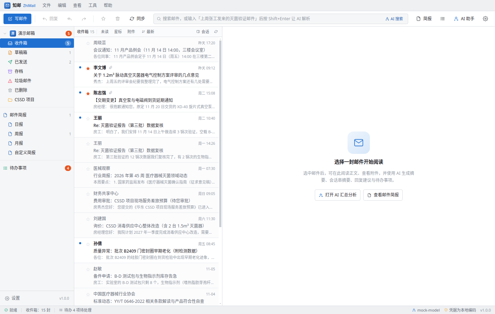
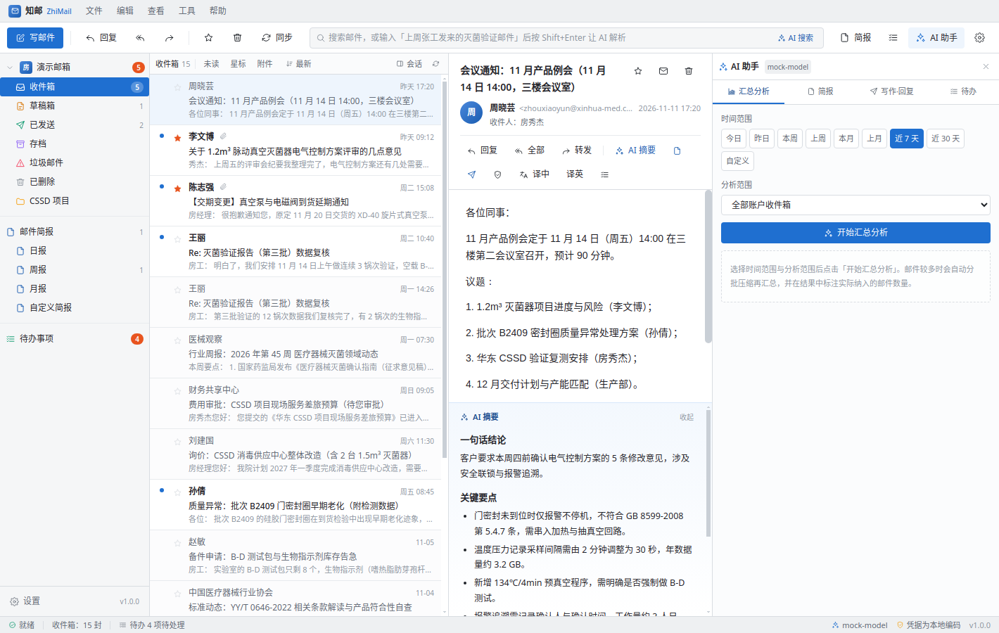
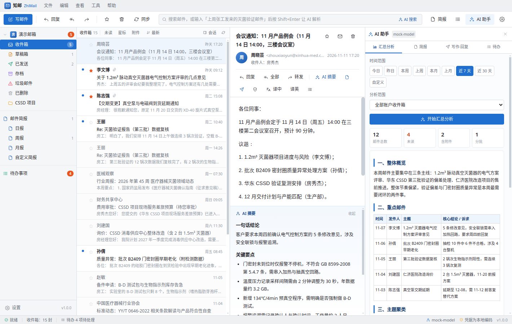
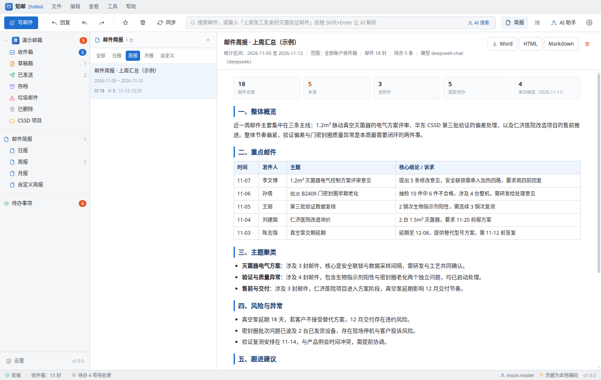
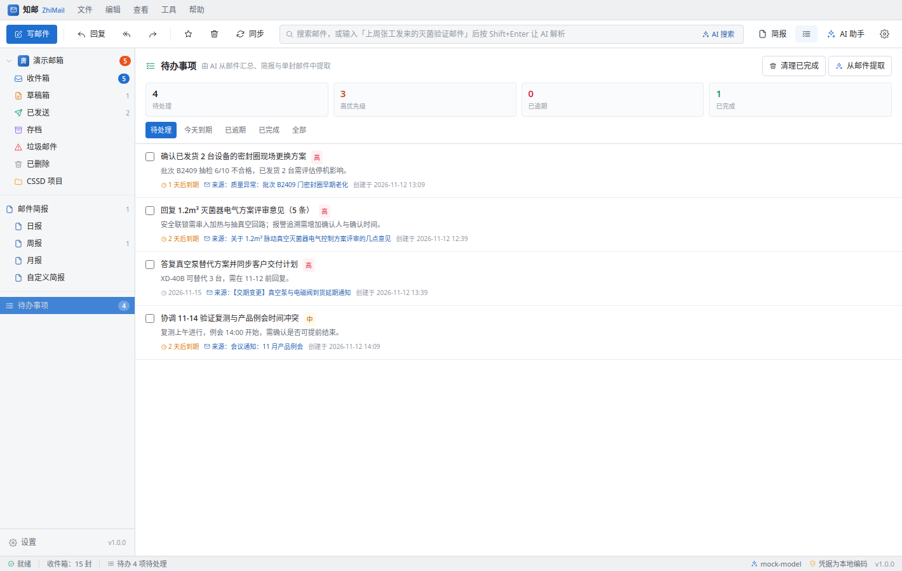
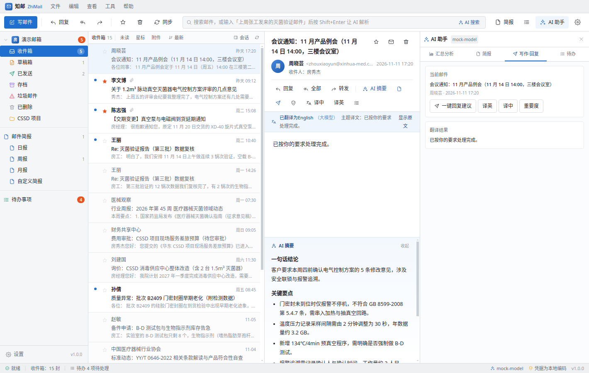
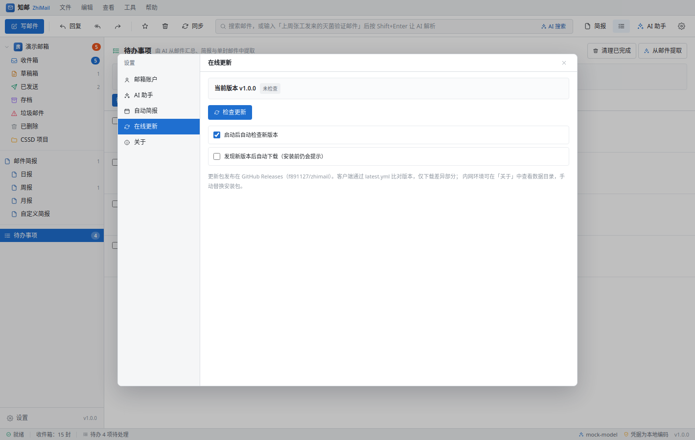

# 知邮 ZhiMail

Foxmail 风格的 Windows 桌面邮件客户端，内置 AI 汇总、简报与待办能力。使用 Electron + React + TypeScript 构建，邮件与设置全部保存在本机，AI 只连接你自己配置的大模型接口。



## 功能特性

### 邮件客户端基础能力

- **多账户**：IMAP 收信 + SMTP 发信，内置 QQ / 163 / 126 / 阿里 / 腾讯企业邮 / Outlook / Gmail 等服务商预设，填邮箱地址即可带出服务器参数。
- **三栏布局**：文件夹树 / 邮件列表 / 阅读窗格，分隔条可拖动，阅读窗格可隐藏。
- **收信**：按时间范围与数量增量同步，IMAP IDLE 长连接实现新邮件即时到达；本地缓存正文与附件，断网也能查看。
- **发信**：写信、回复、回复全部、转发、草稿自动保存（20 秒）、附件选择、富文本编辑。
- **整理**：未读 / 星标 / 附件筛选、时间排序、会话聚合视图、移动文件夹、批量标记与删除，操作会异步同步回服务器。
- **阅读**：正文在沙箱 iframe 中渲染（禁用脚本，链接走系统浏览器），附件可一键用本地程序打开。

### AI 能力（可接入任意 OpenAI 兼容接口）

- **默认 DeepSeek**：开箱即用，同时预置通义千问、火山方舟（豆包）、智谱 GLM、Kimi、腾讯混元、百度千帆、讯飞星火、零一万物、阶跃星辰、百川、MiniMax、硅基流动、OpenRouter、Ollama 本地模型，选「自定义」可填任意兼容地址。
- **长邮件摘要**：结论、关键要点、需要我做的事、建议动作四段式输出，结果内联显示在阅读窗格。
- **会话串摘要**：按 References / 主题归并的整条会话，输出时间线要点、分歧点、当前状态与下一步。
- **时间范围汇总分析**：今日 / 昨日 / 本周 / 上周 / 本月 / 上月 / 近 7 天 / 近 30 天 / 自定义区间；范围可选全部收件箱、全部邮件、当前文件夹或自定义筛选（发件人 + 关键词）。邮件较多时自动分批压缩再汇总，并在结果中标注实际纳入的邮件数量。
- **邮件简报**：把汇总结果固化为结构化简报，自动存入独立的「邮件简报」文件夹（按日报 / 周报 / 月报 / 自定义分组），可导出 Word（可编辑）、HTML、Markdown。
- **自动简报**：按每日 / 每周 / 每月 + 指定时间自动生成，同一周期不会重复生成，应用未运行时会在下次启动补生成。
- **待办事项**：从汇总结果、简报或单封邮件中提取「需要收件人去做」的事项，含优先级、截止日期与来源邮件跳转。
- **一键翻译**：阅读窗格「译中 / 译英」按钮或「工具 → 翻译邮件为中文/英文」菜单；译文直接替换正文显示，可一键切回原文。引擎可选大模型或内置免费引擎（无需 API Key，失败自动回退备用接口）。
- **写作与回复**：续写、润色、正式化、精简、扩写、要点化、译英；回复建议生成正式 / 简洁 / 友好三种草稿，预览确认后再插入正文。
- **智能搜索**：自然语言输入「上周张工发来的灭菌验证邮件」后按 Shift+Enter，由模型解析为结构化检索条件。
- **重要度判定**：输出重要度、紧急度、判断理由与标签。

### 桌面端能力

- **在线更新**：基于 GitHub Releases + `latest.yml`，启动后自动检查（可关）或手动检查，支持后台下载、进度显示、重启安装；也可在 GitHub Actions 的 Windows runner 上自动构建发布。
- **凭据保护**：账户密码与 API Key 使用系统密钥（Windows DPAPI / safeStorage）加密保存，不写入明文。
- **本地优先**：邮件索引与正文存于用户数据目录，隐私模式下 AI 只接收主题与元数据。

## 界面预览

| AI 助手（单封摘要） | 汇总分析 |
| --- | --- |
|  |  |

| 邮件简报中心 | 待办事项 |
| --- | --- |
|  |  |

| 一键翻译 | 在线更新 |
| --- | --- |
|  |  |

## 快速开始

```bash
pnpm install          # 安装依赖（node-linker=hoisted，兼容 electron-builder）
pnpm dev              # Vite 开发服务器 + Electron 热更新
pnpm build            # 构建渲染层与主进程
pnpm start            # 运行已构建版本
pnpm typecheck        # 渲染层 + 主进程类型检查
pnpm dist:win         # 打 Windows NSIS 安装包（产物在 release/）
```

首次启动会播种一个「演示邮箱」，包含 15 封与灭菌器项目相关的示例邮件、1 份周报示例和 4 条待办，便于直接体验全部 AI 功能；在「设置 → 邮箱账户」添加真实邮箱后即可正常收发。

### 邮箱账户配置

1. 设置 → 邮箱账户 → 选择服务商预设（或手动填写 IMAP / SMTP 地址与端口）。
2. 密码处填写**客户端授权码**，不是网页登录密码（QQ、163、126 等均需在网页端开启 IMAP 并生成授权码）。
3. 点击「测试连接」确认 IMAP 与 SMTP 均可用后保存，回到主界面点「同步」。

### AI 配置

1. 设置 → AI 助手 → 服务商预设选择 DeepSeek（默认），Base URL 为 `https://api.deepseek.com/v1`，模型 `deepseek-chat`。
2. 填入 API Key → 「测试连接」，返回一行文字即连通。
3. 需要内网或自建模型时选「自定义」，填写任意 OpenAI Chat Completions 兼容地址（含 `/v1`）。

## 架构

```
electron/
  main.ts                 窗口、生命周期、调度启动、在线更新初始化
  preload.ts              contextBridge 暴露受控 API
  ipc.ts                  IPC 注册（账户/邮件/AI/简报/待办/更新/系统）
  services/
    store.ts              JSON 索引 + 单封邮件独立文件的本地仓储
    crypto.ts             safeStorage 凭据加解密
    imap.ts / smtp.ts     IMAP 同步与 SMTP 发信（imapflow / nodemailer）
    thread.ts             会话串归并
    search.ts             本地检索与自然语言条件启发式解析
    accounts.ts / presets.ts  账户管理与服务商预设
    demo.ts               演示邮箱与示例数据
    brief.ts              简报生成、分组、导出（md/html/docx）
    todo.ts               待办事项
    scheduler.ts          自动简报调度（日/周/月，含补生成）
    translate.ts          翻译服务（大模型 + 内置免费引擎）
    updater.ts            electron-updater 在线更新
    export/               Markdown 解析与 docx 生成
    ai/
      client.ts           OpenAI 兼容客户端（超时、重试、错误归类、并发限流）
      prompts.ts          中文场景提示词
      tasks.ts            摘要/汇总/待办/回复/写作/搜索/翻译/重要度编排
      presets.ts          大模型服务商预设
src/
  layout/                 菜单栏、工具栏、文件夹树、邮件列表、阅读窗格、状态栏
  features/ai              AI 助手面板（汇总分析 / 简报 / 写作回复 / 待办）
  features/brief           简报中心
  features/todos           待办面板
  features/compose         写信窗口（含写作提示侧栏）
  features/settings        设置（账户 / AI / 自动简报 / 在线更新 / 关于）
  store/useAppStore.ts     Zustand 全局状态与业务动作
  lib/                     API 封装、格式化、Markdown 与 HTML 净化、时间范围
scripts/
  mock-llm.mjs             本地模拟 OpenAI 接口，用于无 Key 联调
  e2e-ai.cjs               Electron 内运行的 AI 全链路验证（26 项断言）
  make-icon.py             应用图标生成
  seed-ai-settings.cjs     写入演示用 AI 配置
```

## 数据与隐私

- 数据目录：Windows 为 `%APPDATA%\ZhiMail\zhimail-data`，可在「设置 → 关于」直接打开。
- 结构：`state.json`（账户、文件夹、设置、待办、简报索引）、`messages/<账户>/<文件夹>/<uid>.json`（正文）、`briefs/`、`attachments/`、`secrets.json`（加密凭据）。
- 除主动触发的 AI 请求与邮件服务器通信外，应用不向任何第三方发送数据；无遥测。

## 在线更新与发布

1. `electron-builder.yml` 已配置 `publish: github (f891127/zhimail)`，打包时生成 `latest.yml`。
2. 推送 `v*` 标签会触发 `.github/workflows/release.yml`，在 GitHub 的 Windows runner 上构建并上传安装包与 `latest.yml` 到 Release。
3. 客户端在「设置 → 在线更新」或「帮助 → 检查更新」中比对版本、下载、重启安装。
4. **注意**：electron-updater 匿名下载要求仓库（或 Release 资产）可公开访问；若保持私有仓库，需要改为携带 Token 的私有源或在发布时手动提供安装包。

## 已知限制

- 附件上传：发信附件通过本地文件路径引用，未做 MIME 分块上传大文件（>20MB 时部分服务商会拒收）。
- 日历 / 通讯簿 / 规则过滤尚未实现，聚焦在收信、AI 处理与简报闭环。
- 自动简报依赖应用运行，不注册系统级计划任务（可在后续版本改为 Windows 任务计划）。
- 未做代码签名，首次运行 Windows SmartScreen 可能提示未知发布者。
